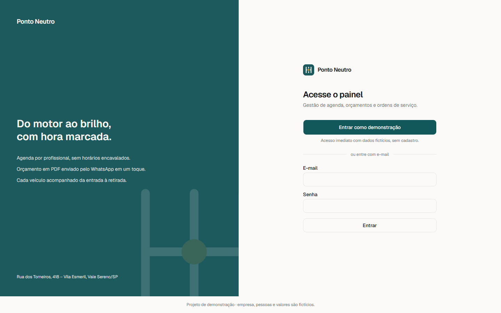
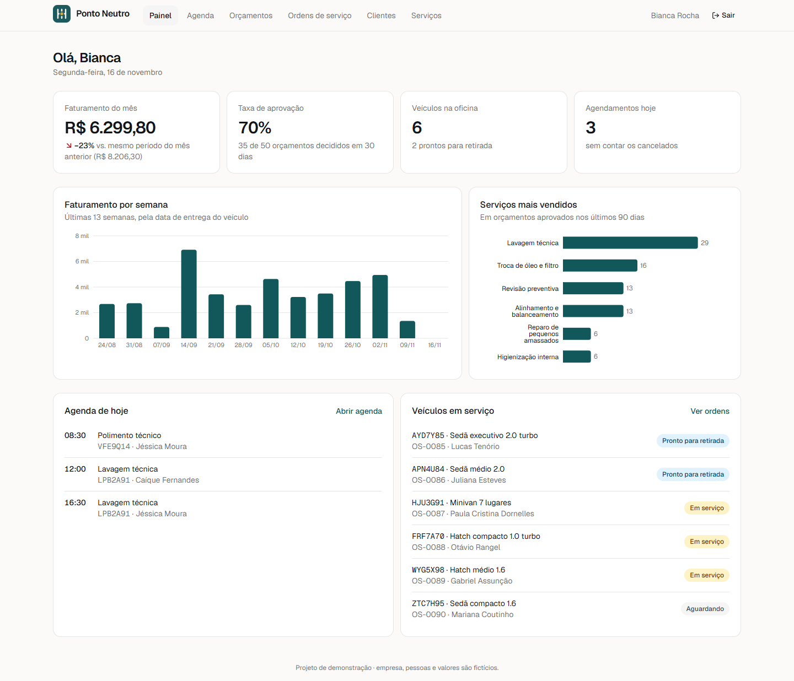
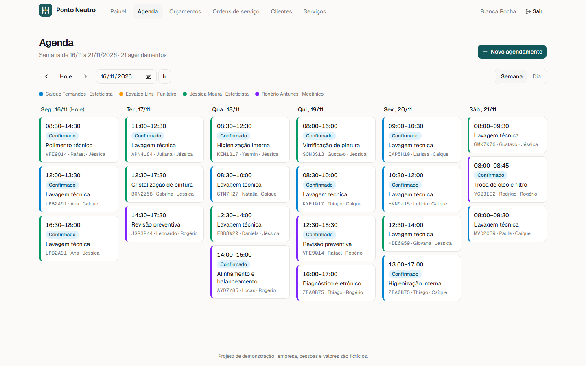
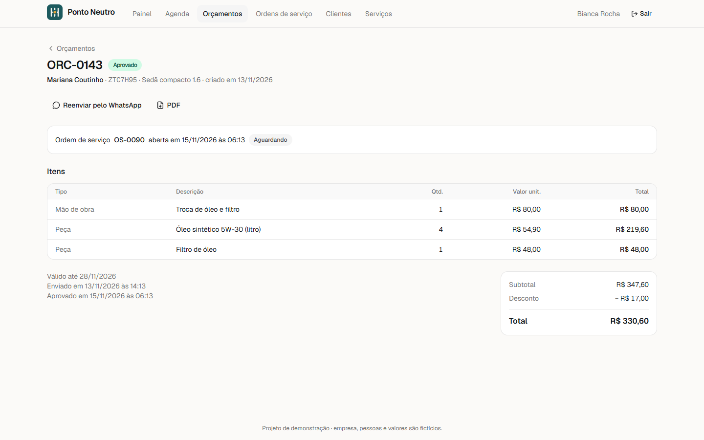
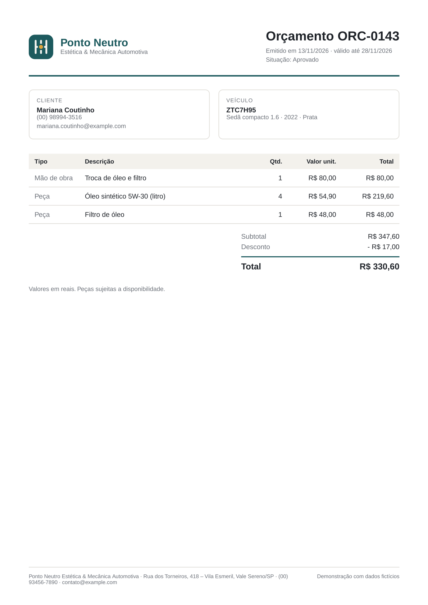
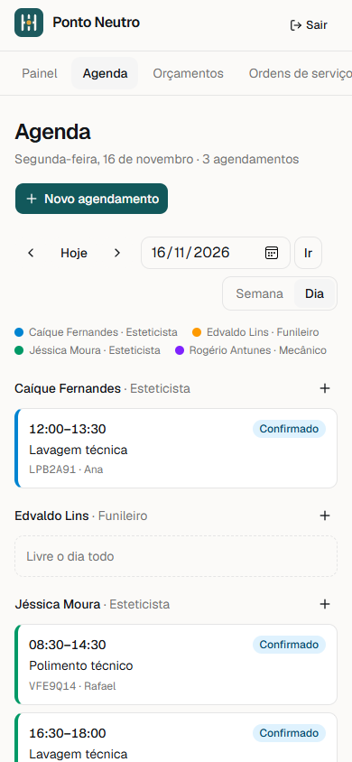
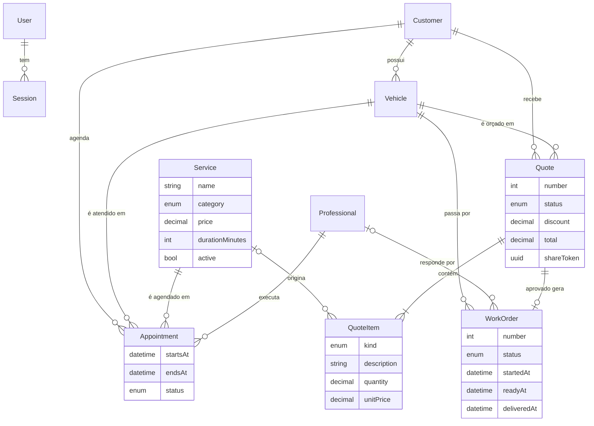

# Ponto Neutro · Gestão para estéticas e oficinas automotivas

> **Do motor ao brilho, com hora marcada.** Agenda, orçamentos e ordens de serviço num só painel, no lugar do caderno e das conversas soltas no WhatsApp.


<!-- Depois do deploy, troque o selo acima por:  -->

## Demonstração

**Link:** _em breve_ (veja o [quadro de pendências](#quadro-de-pendências)).

Na tela de entrada, clique em **Entrar como demonstração**. Não é preciso cadastro. Se preferir digitar, use `demo@example.com` e a senha `demo1234`. Tudo o que aparece é fictício e pode ser alterado à vontade.

## Capturas de tela

| Entrada | Painel |
|---|---|
|  |  |
| **Agenda da semana** | **Orçamento** |
|  |  |
| **PDF do orçamento** | **No celular** |
|  |  |

Outras capturas em [`docs/screenshots`](docs/screenshots): ordens de serviço, histórico por placa, clientes, catálogo e as versões para celular. Elas são geradas por `npm run qa -- --capturas` (veja [Qualidade](#qualidade)).

### Quadro de pendências

| Item | Situação |
|---|---|
| Capturas: entrada, painel, agenda, orçamento, PDF e celular | ✅ Feitas (dados do seed) |
| Publicar na Vercel e colocar o link da demonstração acima | ⏳ Pendente |
| Trocar o selo "deploy pendente" pelo selo da Vercel | ⏳ Pendente |
| Refazer as capturas a partir da versão publicada (o link do WhatsApp passa a mostrar o domínio real) | ⏳ Pendente |
| Preencher o nome na licença e os contatos de LinkedIn e e-mail no fim deste README | ⏳ Pendente |

## Sobre o projeto

Pequenas estéticas e oficinas costumam controlar a agenda num caderno e fechar orçamentos por mensagem. O resultado é conhecido: dois carros marcados no mesmo horário, orçamento que ninguém lembra se foi aprovado, cliente ligando para saber se o carro está pronto e nenhuma visão de quanto se faturou no mês.

Este sistema reúne essas pontas:

- **Agenda** que não deixa marcar o mesmo profissional em dois serviços ao mesmo tempo.
- **Orçamento** montado a partir do catálogo, enviado em PDF pelo WhatsApp e aprovado com um clique.
- **Ordem de serviço** criada na aprovação, acompanhada até a entrega.
- **Painel** com faturamento, taxa de aprovação e o que está acontecendo hoje.

É um projeto de portfólio: a empresa **Ponto Neutro**, a equipe, os clientes e os valores são inventados e servem para simular uma estética em funcionamento.

## Funcionalidades

**Acesso**
- Entrada com e-mail e senha, ou pelo botão **Entrar como demonstração**.
- Sessão guardada num cookie protegido; todas as páginas e ações conferem a sessão no servidor.

**Clientes e veículos**
- Cadastro de clientes (nome, telefone, e-mail, observações) e de veículos (placa Mercosul ou antiga, modelo, cor, ano).
- Busca única por nome, e-mail, final do telefone ou placa.
- **Histórico por placa**: atendimentos, orçamentos, OS e total gasto, numa linha do tempo.
- Atalhos para ligar, chamar no WhatsApp, agendar e orçar a partir da ficha.
- Exclusão bloqueada para quem tem histórico, para não perder registros.

**Agenda**
- Visão da semana (um dia por coluna) e do dia (uma coluna por profissional).
- Criar, editar, mudar a situação (agendado, confirmado, concluído, cancelado) e cancelar.
- O término é calculado pela duração do serviço no catálogo e precisa caber no expediente.
- **Sem conflito de horário** para o mesmo profissional, mesmo com duas pessoas salvando ao mesmo tempo.

**Orçamentos**
- Itens de peças e mão de obra, com quantidade (aceita decimais), valor unitário, desconto em R$ e total calculado na hora.
- Situações: rascunho → enviado → aprovado ou recusado.
- **PDF** com a identidade da empresa e **link para enviar pelo WhatsApp**. O cliente abre o PDF sem login.
- **Aprovar gera a ordem de serviço** automaticamente.

**Ordens de serviço**
- Quadro com as etapas **aguardando → em serviço → pronto para retirada → entregue**, com o horário de cada mudança.
- Troca de responsável e aviso ao cliente pelo WhatsApp quando o carro fica pronto.

**Painel**
- Faturamento do mês comparado ao mesmo período do mês anterior.
- Taxa de aprovação de orçamentos (últimos 30 dias).
- Faturamento por semana e serviços mais vendidos, em gráficos.
- Agenda de hoje e veículos em serviço.

**Catálogo de serviços**
- Preço de mão de obra e duração estimada por serviço, por categoria (estética, mecânica, funilaria).
- Serviços são desativados em vez de excluídos, para não quebrar orçamentos antigos.

## Tecnologias

| Tecnologia | Para quê | Por que esta |
|---|---|---|
| **Next.js 16** (App Router) | Páginas e regras de negócio no mesmo projeto | As telas são montadas no servidor, já com os dados, e as ações dos formulários (*Server Actions*) rodam lá também, sem uma API separada para manter. |
| **TypeScript** | Linguagem | Os tipos pegam erros antes de rodar, inclusive nos dados vindos do banco. |
| **Tailwind CSS 4 + shadcn/ui** | Visual | Componentes acessíveis prontos, com o estilo ajustado à marca. |
| **Prisma 7 + PostgreSQL** | Banco de dados | O Prisma gera consultas tipadas a partir do modelo. PostgreSQL roda em Neon ou Supabase, compatíveis com a Vercel. |
| **Zod** | Validação | Todo formulário é validado no servidor, com mensagens em português. |
| **@react-pdf/renderer** | PDF do orçamento | O PDF é desenhado com componentes React e gerado no servidor, sem precisar de um navegador. |
| **Recharts** | Gráficos do painel | Gráficos em React, simples de manter na paleta da marca. |
| **Node test runner + Playwright + axe** | Qualidade | Testes das contas e datas, e auditoria de acessibilidade das telas. |

## Estrutura e modelo de dados

```
prisma/
  schema.prisma        modelo de dados
  migrations/          histórico de mudanças no banco
  seed.ts              dados fictícios (um comando popula ou reseta)
scripts/qa.mjs         auditoria de acessibilidade e capturas de tela
docs/screenshots/      imagens usadas neste README
src/
  app/
    login/             tela de entrada e ações de login
    (app)/             área protegida: painel, agenda, orcamentos, ordens, clientes, veiculos, servicos
    compartilhar/      link público do PDF do orçamento
  components/          componentes reaproveitados (campos, botões, cabeçalhos, logotipo)
  lib/                 regras e utilidades: sessão, datas no fuso de SP, contas do orçamento, PDF, painel
```



## Como rodar localmente

**Pré-requisitos:** Node.js 20 ou superior. Não é preciso instalar PostgreSQL nem Docker: o Prisma sobe um banco local.

```bash
git clone https://github.com/Joaopedro0s/ponto-neutro.git
cd ponto-neutro
npm install            # instala as dependências e gera o cliente do Prisma
npm run db:dev         # sobe o PostgreSQL local em segundo plano
cp .env.example .env   # as portas padrão do passo anterior já estão no exemplo
npm run db:migrate     # cria as tabelas
npm run db:seed        # popula (ou reseta) os dados fictícios
npm run dev            # abre em http://localhost:3000
```

Variáveis do `.env` (o modelo está em [`.env.example`](.env.example)):

| Variável | Uso |
|---|---|
| `DATABASE_URL` | Conexão PostgreSQL. Qualquer provedor serve. |
| `SHADOW_DATABASE_URL` | Banco auxiliar usado só por `npm run db:migrate` no ambiente local. |
| `DATABASE_POOL_MAX` | Só para o banco local do `prisma dev`, que atende uma conexão por vez. Não defina em produção. |

As datas do seed são relativas ao dia em que ele roda. Rodar `npm run db:seed` de novo "atualiza" a demonstração para os últimos 3 meses.

### Deploy na Vercel

1. Crie um banco PostgreSQL gratuito no [Neon](https://neon.tech) ou no [Supabase](https://supabase.com) e copie a URL de conexão.
2. Na Vercel, importe o repositório e cadastre `DATABASE_URL` nas variáveis de ambiente. Não use `SHADOW_DATABASE_URL` nem `DATABASE_POOL_MAX` em produção.
3. Publique. O script `vercel-build` aplica as migrações (`prisma migrate deploy`) antes de gerar o site.
4. Popule o banco de produção uma vez, do seu computador:
   ```bash
   DATABASE_URL="url-do-banco-de-producao" npm run db:seed
   ```
5. Coloque o link no topo deste README e marque o [quadro de pendências](#quadro-de-pendências).

### Qualidade

```bash
npm test                    # contas do orçamento, datas, fuso, placas, telefones e senhas
npm run lint                # padrões de código
npm run typecheck           # tipos
npm run qa                  # com o app rodando: acessibilidade (WCAG 2.1 AA) e rolagem lateral em 15 telas
npm run qa -- --capturas    # o mesmo, salvando as capturas em docs/screenshots
```

O `qa` usa o Edge instalado no computador. Para usar o Chrome, rode com `QA_BROWSER=chrome`.

## Decisões de design e aprendizados

**Produto e interface**
- **Identidade sem clichês**: a marca usa o "H" do câmbio manual com o ponto no neutro, verde-petróleo como cor principal e âmbar só em detalhes. O painel tem poucos números grandes e gráficos de uma cor só.
- **Agenda em listas, não em grade de horas**: continua legível no celular, sem rolagem lateral.
- **Pensado para o celular desde o início**: tabelas viram listas, os itens do orçamento viram cartões e o menu vira uma faixa rolável.
- **Acessibilidade**: rótulo em todos os campos, foco visível, link "Pular para o conteúdo", contraste conferido e gráficos com os mesmos dados em tabela para leitores de tela. A auditoria automática passa sem apontamentos nas 15 telas verificadas.
- **Mensagens em português em todo lugar**, inclusive as de validação padrão.

**Regras de negócio**
- **Conflito de horário garantido no banco**: a checagem e a gravação rodam numa transação `Serializable`, então dois salvamentos simultâneos não ocupam o mesmo horário. Um horário que encosta no fim de outro (09:00–10:00 e 10:00–11:00) não é conflito.
- **Faturamento = OS entregues**: o dinheiro entra quando o carro é retirado. O comparativo usa o mesmo trecho do mês anterior (de 1 a 16 de outubro contra 1 a 16 de novembro), para não comparar meio mês com um mês inteiro.
- **Fluxo do orçamento**: rascunho → enviado → aprovado ou recusado. Cada passagem é conferida no servidor, e aprovar abre a OS na mesma transação.
- **Valores em centavos**: subtotal, desconto e total são calculados em números inteiros, com a mesma função no navegador (prévia) e no servidor (valor gravado).
- **Fuso fixo de São Paulo**: a Vercel roda em UTC, então todas as datas são convertidas explicitamente.
- **Exclusão protegida**: clientes e veículos com histórico não podem ser excluídos, e serviços do catálogo são desativados em vez de apagados.

**Técnica**
- **Sessão própria em vez de biblioteca**: token aleatório em cookie protegido, só o hash no banco e senha com `scrypt`, nativo do Node. É simples de entender e não depende de serviço externo.
- **Link público do PDF por token**: cada orçamento tem um UUID aleatório, e é esse link que vai pelo WhatsApp. Quem tem o link vê aquele orçamento, e só ele.
- **`cacheComponents` desligado**: o painel é todo por usuário e muda a cada acesso, então a renderização dinâmica padrão é mais simples.
- **Aprendizado com o banco local**: o PostgreSQL embutido do `prisma dev` atende uma conexão por vez. Consultas em paralelo derrubavam conexões, o que levou ao `DATABASE_POOL_MAX` só para o ambiente local.

**Dados fictícios (decisões tomadas sem interromper o trabalho)**
- **Veículos sem marca real**: o modelo é uma descrição genérica ("Hatch compacto 1.0", "SUV médio híbrido").
- **Telefones com DDD (00)**, que não existe, e e-mails no domínio `example.com`.
- **Funilaria no catálogo**: o escopo pede um funileiro na equipe, então o catálogo inclui "Reparo de pequenos amassados".
- **Fechado aos domingos**: num domingo, "agendamentos do dia" fica vazio de propósito.
- **Volume**: cerca de 300 agendamentos e 150 orçamentos em 3 meses, com sextas e sábados mais cheios e movimento crescendo rumo ao fim do ano.

## Próximos passos

- **Notificações automáticas pelo WhatsApp** (lembrete de agendamento e aviso de carro pronto), usando a API oficial em vez de links.
- **Pagamento online** do orçamento aprovado (Pix e cartão).
- **Multiempresa**: várias oficinas no mesmo sistema, cada uma com seus dados, equipe e identidade.

## Aviso

Este é um **projeto de demonstração**. A empresa "Ponto Neutro", o endereço, a equipe, os clientes, as placas, os telefones e os valores são **fictícios**. Qualquer semelhança com pessoas ou empresas reais é coincidência. Não há CPFs nem dados pessoais verdadeiros.

## Licença e contato

Distribuído sob a licença MIT. Veja [LICENSE](LICENSE).

- GitHub: [@Joaopedro0s](https://github.com/Joaopedro0s)
- LinkedIn: [seu-perfil](https://www.linkedin.com/in/seu-perfil)
- E-mail: seu-email@exemplo.com
